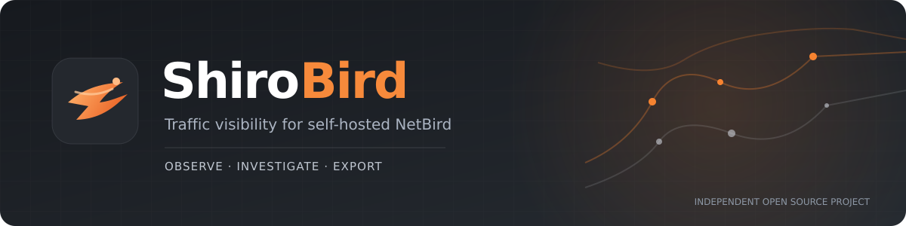
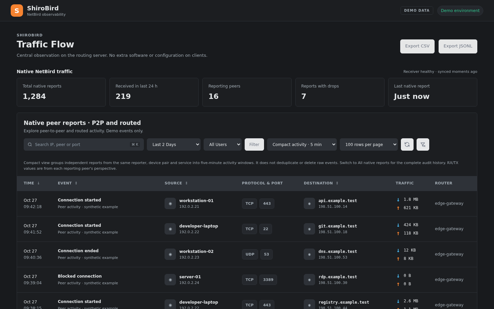
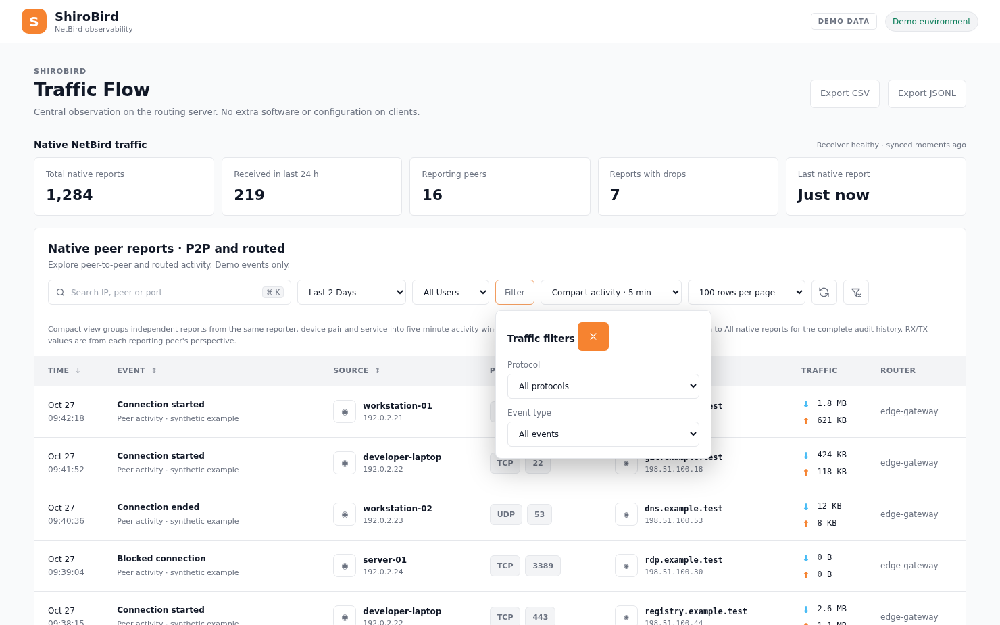
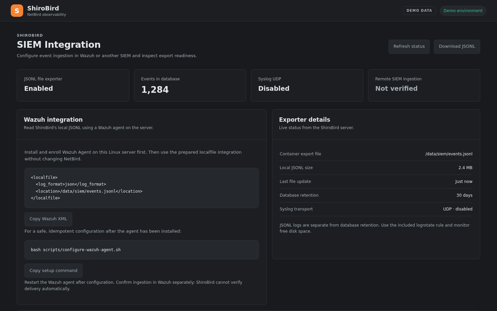
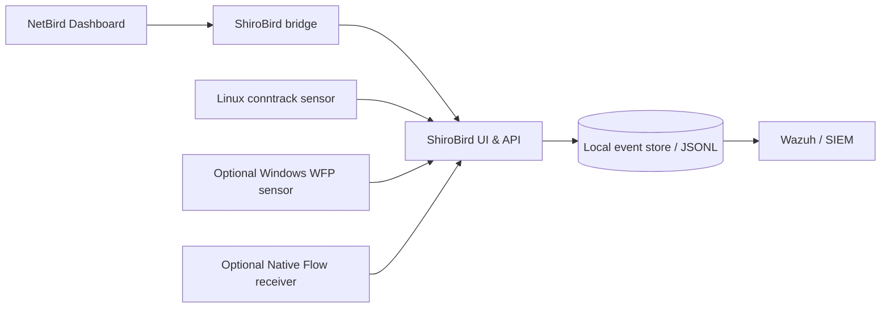

<div align="center">
  <a href="https://github.com/Richailo/ShiroBird">
    
  </a>
  <p>
    <a href="https://github.com/Richailo/ShiroBird/actions/workflows/ci.yml"></a>
    <a href="https://github.com/Richailo/ShiroBird/releases/tag/v0.1.0-rc.1"></a>
    <a href="LICENSE"></a>
    <a href="https://github.com/Richailo?tab=packages"></a>
  </p>
  <p><strong>Self-hosted traffic observability and SIEM export, integrated into the NetBird dashboard.</strong></p>
  <p>
    <a href="#-quick-start">Quick start</a> ·
    <a href="#-screenshots">Screenshots</a> ·
    <a href="#-features">Features</a> ·
    <a href="docs/docker-release.md">Docker guide</a> ·
    <a href="https://github.com/Richailo/ShiroBird/releases">Releases</a>
  </p>
</div>

> [!IMPORTANT]
> **Current release: `v0.1.0-rc.1` (pre-release).** ShiroBird is an independent community project, not affiliated with or endorsed by NetBird, and not a Docker Official Image.

ShiroBird adds a NetBird-styled **Traffic Flow** view and **SIEM Integration** to an existing self-hosted NetBird dashboard. Investigate observed connections, inspect reporting coverage and export event metadata — without changing NetBird's client software or its upstream dashboard code.

## 📸 Screenshots
<p align="center">
  <a href="docs/media/traffic-flow-demo.png"></a>
  <br />
  <sub><strong>Traffic Flow</strong> · native reports, event types, peer metadata and connection details</sub>
</p>

<table>
  <tr>
    <td width="50%">
      <a href="docs/media/traffic-filters-demo.png"></a>
      <p align="center"><strong>Traffic filters</strong> · light theme</p>
    </td>
    <td width="50%">
      <a href="docs/media/siem-integration-demo.png"></a>
      <p align="center"><strong>SIEM Integration</strong> · Wazuh and JSONL</p>
    </td>
  </tr>
</table>

<sub>These are screenshots of the ShiroBird UI rendered with **synthetic demonstration data** (documentation IP ranges and fictional devices). They do not depict a real network or verified live traffic.</sub>

## ✨ Features

| Observe | Investigate | Export & integrate |
| --- | --- | --- |
| ✓ Native peer report summaries and recent activity | ✓ Search, date ranges, sorting and filters | ✓ Local JSONL event export |
| ✓ Peer names, endpoints, protocols and ports | ✓ Connection timelines and event details | ✓ CSV and NDJSON downloads |
| ✓ Optional Linux conntrack observations | ✓ Reporting peer and router context where available | ✓ Wazuh agent integration |
| ✓ Optional Windows WFP telemetry | ✓ Light and dark NetBird-style UI | ✓ Optional UDP Syslog forwarding |

**Native Flow receiver:** An optional component for compatible NetBird management deployments. Installing the receiver alone does not enable reporting from NetBird peers.

## 🚀 Quick start
On a **new Linux deployment** with Docker Engine, Docker Compose v2 and OpenSSL installed:

```bash
git clone --branch v0.1.0-rc.1 --depth 1 https://github.com/Richailo/ShiroBird.git
cd ShiroBird
sudo SHIROBIRD_INSTALL_MODE=pull bash scripts/install-release.sh
```

The installer generates local credentials, uses [public versioned GHCR images](https://github.com/Richailo?tab=packages), keeps state in `./data`, and detects an existing `netbird-dashboard` container. Without NetBird, the standalone API/UI binds to `127.0.0.1:8666`.

> [!CAUTION]
> The installer intentionally **refuses to replace an existing ShiroBird container**. Back up `.env` and `data/` before upgrading a live installation. Follow the [Docker release guide](docs/docker-release.md) for upgrades and rollback.

### Integrate with your NetBird dashboard

For a supported self-hosted NetBird deployment, point **only the Dashboard HTTP upstream** in your reverse proxy to the ShiroBird bridge on port `8082` (instead of dashboard port `8080`). Keep NetBird's management API, OIDC, gRPC, relay and WebSocket routes unchanged.

The bridge listens on loopback by default. If your proxy runs elsewhere, bind it to an appropriate **private** interface and restrict access using your firewall. Use HTTPS for browser access.

**[Full NetBird integration guide →](docs/netbird-tab.md)** · **[Docker / Portainer guide →](docs/docker-release.md)**

### Registry images

| Component | Docker image |
| --- | --- |
| Core dashboard and API | `ghcr.io/richailo/shirobird:0.1.0-rc.1` |
| Dashboard bridge | `ghcr.io/richailo/shirobird-bridge:0.1.0-rc.1` |
| Customize service | `ghcr.io/richailo/shirobird-customize:0.1.0-rc.1` |
| Optional Native Flow receiver | `ghcr.io/richailo/shirobird-native-flow:0.1.0-rc.1` |

Published for **Linux AMD64 and ARM64**. Offline AMD64 archives and SHA-256 checksums are included in the [pre-release downloads](https://github.com/Richailo/ShiroBird/releases/tag/v0.1.0-rc.1).
## 🧩 How it fits together



ShiroBird is an **observability extension**, not a NetBird policy enforcement engine. NetBird's original authentication and network functions stay in charge. The embedded UI reuses an authenticated NetBird session with server-side identity and role verification; the standalone service uses its own administrator token.

## 📚 Documentation

| Guide | Description |
| --- | --- |
| [Docker release & Portainer](docs/docker-release.md) | Install, configuration, backup and rollback |
| [NetBird integration](docs/netbird-tab.md) | Dashboard bridge, routing and reverse proxy |
| [Traffic Flow](docs/traffic-flow.md) | Coverage, metrics and limitations |
| [Central observation](docs/central-observation.md) | Linux routing-server monitoring |
| [Windows WFP sensor](docs/windows-wfp.md) | Optional Windows connection audit data |
| [Wazuh integration](docs/wazuh.md) | Export and SIEM collection |
| [Security](docs/security.md) | Authentication and deployment precautions |
## 🔐 Security & limitations

- **Traffic visibility depends on sensors and reporting coverage.** A Linux conntrack sensor only observes connections passing through its host. Direct P2P traffic elsewhere is not automatically visible.
- **Do not interpret observed connections as verified NetBird policy allow/deny decisions.** Windows WFP blocked/allowed events describe the Windows filtering system, not necessarily a specific NetBird rule.
- **Native Flow needs a compatible management adapter.** Receiver installation alone does not activate peer reporting.
- **Syslog over UDP is unencrypted** and has no delivery acknowledgement. Use a trusted segment or protected tunnel and verify ingestion at your SIEM.
- Keep `.env`, API tokens, logs and `data/` private. Use HTTPS, restrict the bridge port, and review [the security guide](docs/security.md).

## 🤝 Community & development

Bug reports and proposals are welcome in [GitHub Issues](https://github.com/Richailo/ShiroBird/issues). Include the ShiroBird version, NetBird deployment type, reproduction steps and **redacted** logs. To run the Python tests:

```bash
python3 -m unittest discover -s tests -v
```

The `main` branch tracks active development. For reproducible deployments, **use a tagged release** rather than `main`.

---

<p align="center">
  Released under the <a href="LICENSE">MIT License</a> ·
  Built independently for the self-hosted NetBird community.
</p>
